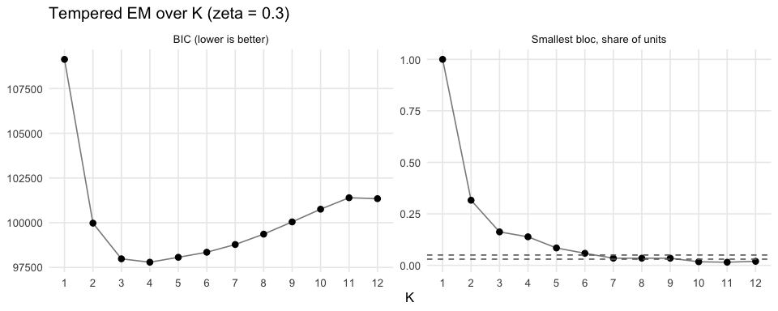
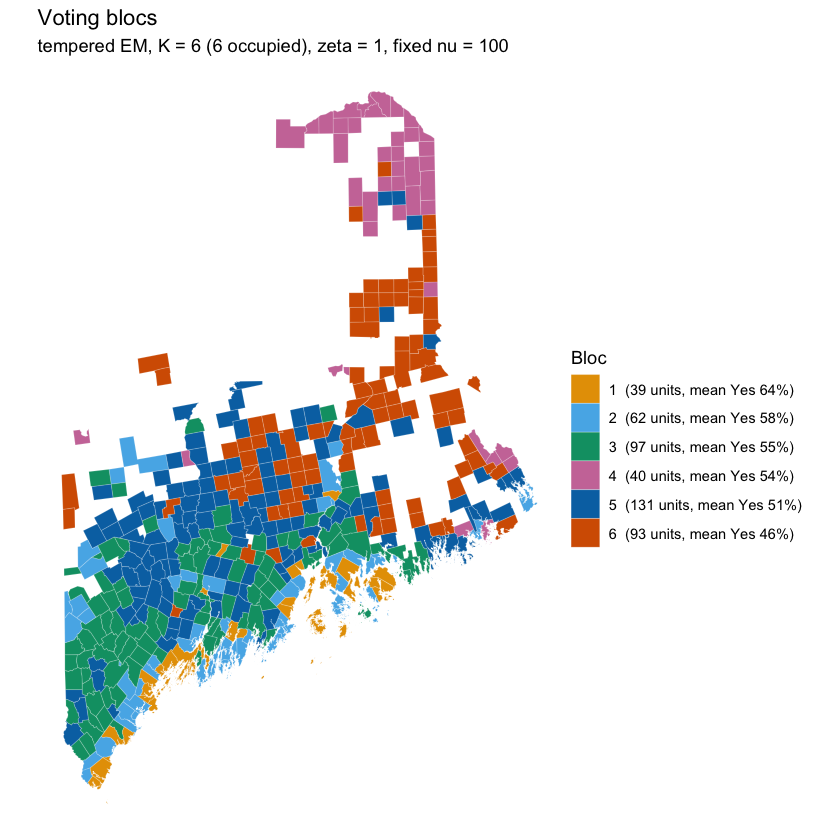
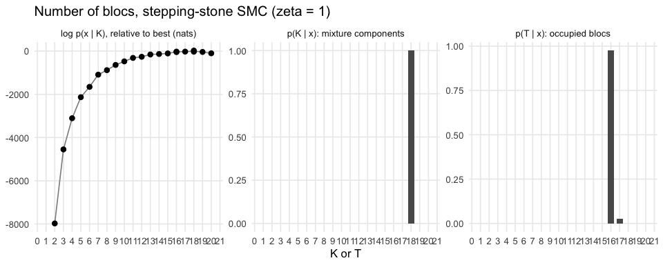
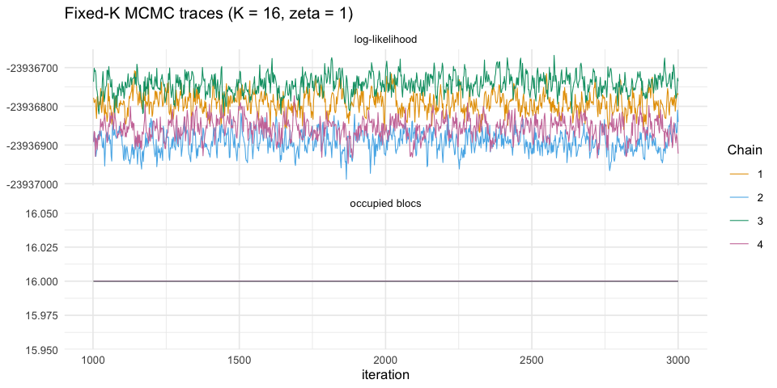
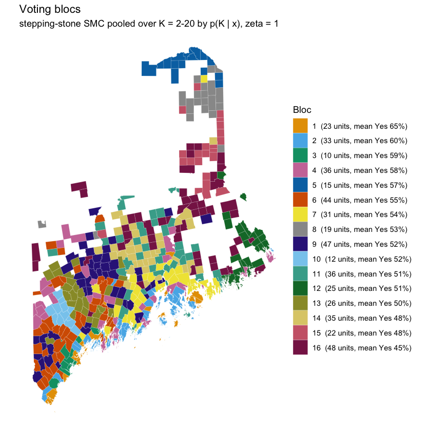
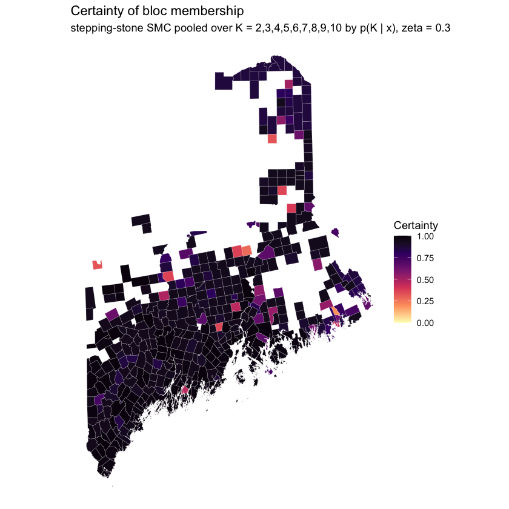
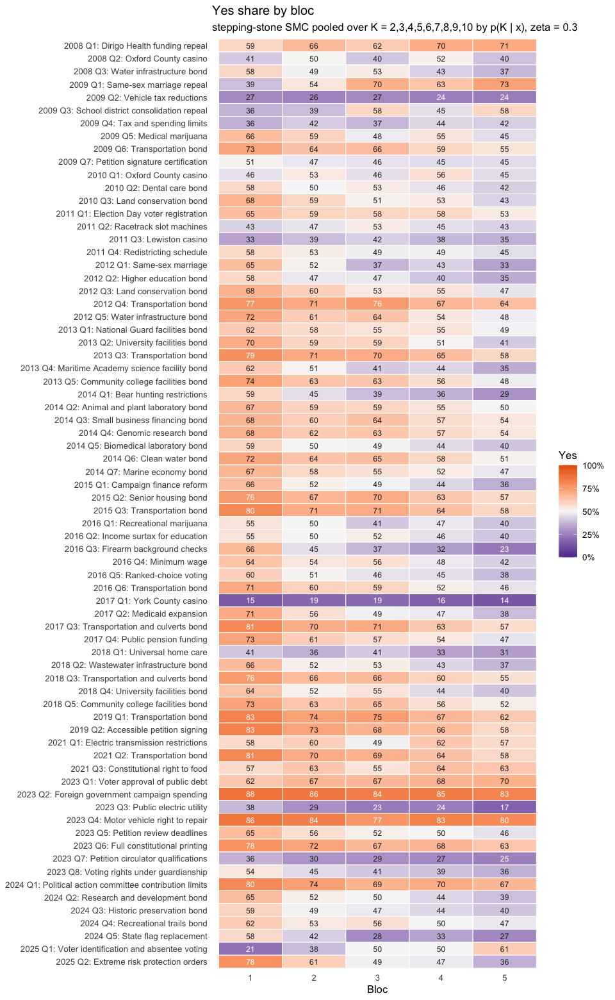
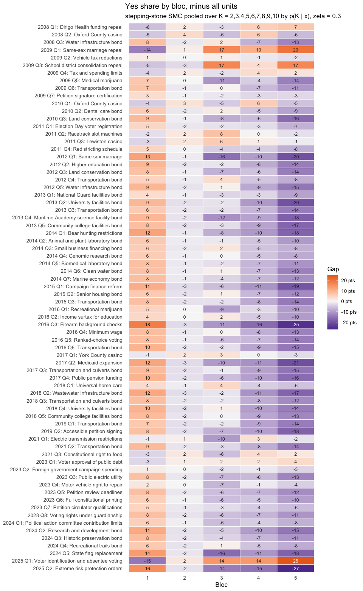
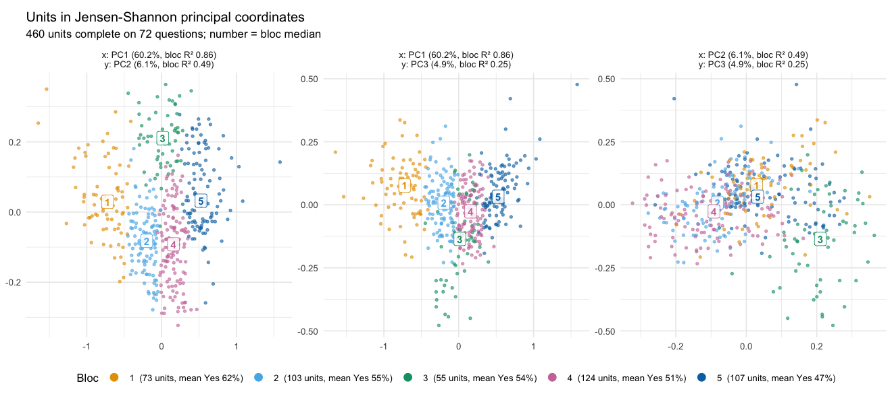
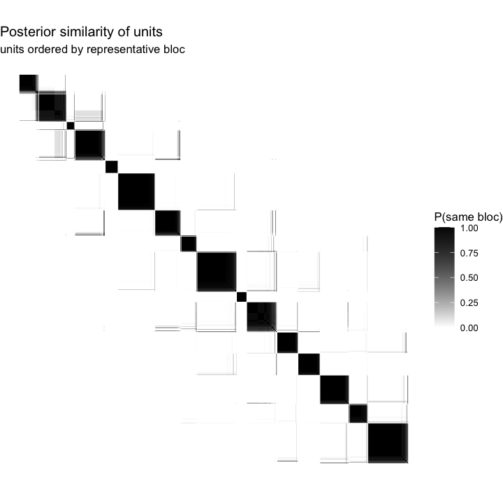

Tutorial: voting blocs in Maine with Elections.BBMM
================

- [1. Installing the package and getting the test
  data](#1-installing-the-package-and-getting-the-test-data)
  - [Your own data](#your-own-data)
- [2. The model in brief](#2-the-model-in-brief)
- [3. Fast: tempered EM](#3-fast-tempered-em)
- [4. Slow: the stepping-stone
  sampler](#4-slow-the-stepping-stone-sampler)
  - [Fixed-K MCMC](#fixed-k-mcmc)
- [5. Posterior summaries and how to read
  them](#5-posterior-summaries-and-how-to-read-them)
  - [Where the blocs are](#where-the-blocs-are)
  - [What the blocs vote for](#what-the-blocs-vote-for)
  - [Questions the blocs do not
    explain](#questions-the-blocs-do-not-explain)
  - [The shape of the blocs: Jensen–Shannon principal
    coordinates](#the-shape-of-the-blocs-jensenshannon-principal-coordinates)
  - [How settled is the partition?](#how-settled-is-the-partition)
  - [Comparing the methods](#comparing-the-methods)
- [6. Where to go next](#6-where-to-go-next)
  - [References](#references)

This tutorial fits the beta-binomial mixture model (BBMM) to the test
data that ship with the package – Maine’s 72 statewide referendums of
2008–2025 in its 462 towns – in two ways: a fast tempered EM fit, and
the slow but fully Bayesian stepping-stone sampler. It then walks
through the posterior summaries and how to read them.

Code chunks marked **long** were run once on an Apple M4 Pro laptop (10
threads); their results are loaded from the package so that this
document builds quickly. Running them yourself gives the same numbers
(the seeds are set), on the time scales quoted.

# 1. Installing the package and getting the test data

Install from GitHub. The package compiles C++ code, so you need a
compiler: the Xcode command-line tools on macOS
(`xcode-select --install`), Rtools on Windows, or `build-essential` on
Linux. Maps also need the **sf** package.

``` r
install.packages(c("remotes", "sf"))
remotes::install_github("cascobayesian/Elections.BBMM", build_vignettes = TRUE)
library(Elections.BBMM)
```

The test data are part of the package: `maine` (the votes),
`maine_questions` (what each question was) and `maine_towns()` (town
boundaries).

``` r
maine
#> BBMM data: 462 units x 72 questions, 37,279,962 votes; 0.1% of cells empty
#> Median votes per cell 504; pooled Yes share 0.555
head(maine_questions[, c("question_id", "label", "statewide_yes")])
#>         question_id                                         label statewide_yes
#> 1 REFERENDUM_2008_1         2008 Q1: Dirigo Health funding repeal         64.65
#> 2 REFERENDUM_2008_2                 2008 Q2: Oxford County casino         46.16
#> 3 REFERENDUM_2008_3            2008 Q3: Water infrastructure bond         50.27
#> 4 REFERENDUM_2009_1             2009 Q1: Same-sex marriage repeal         52.90
#> 5 REFERENDUM_2009_2               2009 Q2: Vehicle tax reductions         25.89
#> 6 REFERENDUM_2009_3 2009 Q3: School district consolidation repeal         41.68
maine$X[1:3, 1:4]   # Yes votes
#>         REFERENDUM_2008_1 REFERENDUM_2008_2 REFERENDUM_2008_3 REFERENDUM_2009_1
#> ABBOT                 296               190               117               242
#> ACTON                 930               699               537               564
#> ADDISON               403               161               177               324
maine$M[1:3, 1:4]   # Yes + No votes
#>         REFERENDUM_2008_1 REFERENDUM_2008_2 REFERENDUM_2008_3 REFERENDUM_2009_1
#> ABBOT                 389               392               384               339
#> ACTON                1335              1340              1299              1020
#> ADDISON               610               613               599               479
```

A `bbmm_data` object is two matrices with one row per unit (here, a town
or a group of towns that report together) and one column per question:
Yes votes `X` and two-option totals `M`. Blank ballots are left out. A
cell with no votes – a question that was not on that unit’s ballot – is
`NA` and simply contributes nothing.

## Your own data

Election offices usually publish one row per unit with a Yes and a No
column per question. The raw Maine file in the repository has that
layout, and `bbmm_data_from_wide()` reads it:

``` r
url <- paste0("https://raw.githubusercontent.com/cascobayesian/Elections.BBMM/main/",
              "data-raw/Maine.Ref/maine_referendum_2008_2025.csv")
raw <- read.csv(url, check.names = FALSE)
names(raw)[1:5]
#> "TOWN" "REFERENDUM_2008_1_YES" "REFERENDUM_2008_1_NO" "REFERENDUM_2008_2_YES" ...
my_data <- bbmm_data_from_wide(raw, id = "TOWN", yes_suffix = "_YES", no_suffix = "_NO")
```

With two matrices of Yes counts and totals, use `bbmm_data(yes, total)`
instead. Units must be the same across all questions, so if district
lines moved over the years, put every election on one set of units
first.

# 2. The model in brief

Each unit belongs to one bloc. A bloc *k* has a Yes probability $p_{kq}$
for every question *q*; a unit in bloc *k* casts its $M_{iq}$ votes on
question *q* as a beta-binomial draw with mean $p_{kq}$ and
concentration $\nu_k$, so units in a bloc scatter around the bloc’s
profile, more tightly when $\nu_k$ is large. The blocs are found from
all questions at once: two towns are in the same bloc when they vote
alike across the board, not on any one question.

**Tempering.** A town casts hundreds or thousands of votes on each of 72
questions, so the ordinary likelihood treats every small, persistent
difference between towns as decisive, and the number of blocs keeps
growing with the data. All three fitting methods therefore raise the
likelihood to a power $\zeta \le 1$ (the coarsened posterior of Miller
and Dunson, 2019): roughly, they look for structure that would survive
if the data were a fraction $\zeta$ of their size. Smaller $\zeta$ gives
fewer, broader blocs. This tutorial uses $\zeta = 0.3$ throughout. Treat
$\zeta$ as a choice about the grain of the analysis, and check that the
conclusions you care about hold at neighbouring values.

# 3. Fast: tempered EM

`bbmm_em_select()` fits the model by expectation-maximisation for each
*K* in a range, from several random starts each, holding the
concentration fixed at $\nu = 100$ for every bloc.

``` r
# long: about 1 minute on 10 cores, 4 minutes on 4
sel <- bbmm_em_select(maine, K = 1:12, zeta = 0.3, n_starts = 10, seed = 2026, cores = 10)
```

``` r
sel
#> BBMM tempered EM over K = 1-12 (zeta = 0.3, nu = 100; 462 units x 72 questions)
#>   K   loglik occupied min_share      BIC converged n_at_best
#>   1 -54191.1        1 1.0000000 109131.9      TRUE        10
#>   2 -49232.5        2 0.3160173  99974.9      TRUE        10
#>   3 -47855.5        3 0.1623377  97980.9      TRUE        10
#>   4 -47380.2        4 0.1385281  97790.4      TRUE         8
#>   5 -47138.2        5 0.0844156  98066.4      TRUE         4
#>   6 -46898.8        6 0.0584416  98347.8      TRUE         4
#>   7 -46734.6        7 0.0346320  98779.5      TRUE         3
#>   8 -46644.7        8 0.0346320  99359.7      TRUE         1
#>   9 -46606.8        9 0.0346320 100044.1      TRUE         1
#>  10 -46581.8       10 0.0173160 100754.0      TRUE         1
#>  11 -46522.2       11 0.0151515 101395.0      TRUE         1
#>  12 -46496.6       11 0.0194805 101343.8      TRUE         1
#> 
#> Selected number of blocs:
#>          BIC min_share_3% min_share_5% 
#>            4            9            6
```

Each row is the best of the 10 starts at that *K*: its tempered
log-likelihood, the number of components that hold at least one town
(`occupied`), the smallest bloc’s share of towns, BIC, and how many
starts reached that same best fit (`n_at_best`). When few starts agree,
the partition at that *K* is one of several nearly equally good ones,
and conclusions about individual small blocs should be held loosely.

Two rules for choosing the number of blocs are reported. BIC balances
fit against the number of parameters; with tempered likelihoods it is
only a heuristic. The minimum-share rule takes the largest *K* at which
every bloc still holds at least 3% (or 5%) of the units – it stops
before the model starts carving off blocs of a handful of towns.

``` r
plot_em_selection(sel)
```



On Maine the rules disagree: BIC picks 4 blocs, the 5% rule 6 and the 3%
rule 9. From *K* = 5 on, fewer than half of the starts reach the best
fit, and beyond *K* = 7 only one does: the extra blocs are not well
determined. We carry the 5% fit forward; the stepping-stone sampler in
the next section addresses the number of blocs directly.

Pick a fit and summarise it:

``` r
K_em <- sel$selected[["min_share_5%"]]
fit_em <- sel$fits[[as.character(K_em)]]
s_em <- bloc_summary(fit_em, maine)
s_em
#> Bloc summary: tempered EM, K = 6 (6 occupied), zeta = 0.3, fixed nu = 100 
#>  bloc units share    ballots mean_yes  nu certainty
#>     1    39 0.084  8,270,147    0.636 100     0.994
#>     2    62 0.134  8,303,343    0.583 100     0.975
#>     3    99 0.214 10,598,773    0.546 100     0.952
#>     4    27 0.058  1,217,226    0.546 100     0.988
#>     5   144 0.312  7,165,762    0.507 100     0.937
#>     6    91 0.197  1,724,711    0.461 100     0.965
```

``` r
plot_bloc_map(s_em, maine_towns())
```



To fit a single *K*, use `bbmm_em(maine, K = 6, zeta = 0.3)`. EM also
returns each town’s membership probabilities (`fit_em$gamma`); at this
$\zeta$ almost all are close to 0 or 1, which says more about the
fixed-$\nu$ model than about how certain the partition is.

# 4. Slow: the stepping-stone sampler

EM gives one best partition at each *K* and no measure of uncertainty,
and choosing *K* rests on rules of thumb. The Bayesian version of the
model puts priors on everything – including a separate concentration
$\nu_k$ for each bloc – and the stepping-stone sampler computes the
**marginal likelihood** $p(x \mid K)$ for each *K*. With a prior on *K*
(geometric, favouring fewer blocs) that gives the posterior probability
of each number of blocs, and every run also leaves a weighted sample of
partitions from the posterior at its *K*.

The sampler moves a population of 200 “particles” from the prior to the
tempered posterior through a few hundred intermediate distributions, so
it is far slower than EM.

> **How long will this take?** On Maine (462 towns x 72 questions), one
> *K* took between 4 minutes and 10 minutes on 10 threads, and *K* = 2
> to 10 took 69 minutes in all. Time grows with units x questions and
> with *K*: a state’s precincts (thousands of units) can take hours to
> days per *K*. Start with a small range of *K* around the EM answer,
> use as many threads as you can spare (`n_threads`), and for big data
> run each *K* as a separate job and combine them with
> `evidence_from_fits()`.

``` r
# long: about 70 minutes on 10 threads (plus two extra replicates, 20 minutes)
ev <- bbmm_evidence(maine, K = 2:10, zeta = 0.3, n_threads = 10, seed = 2026)

# or, one K at a time (e.g. as separate jobs), then combine:
fits <- lapply(2:10, function(K) bbmm_ss(maine, K = K, zeta = 0.3, seed = 2026 + K, n_threads = 10))
# a second replicate at K = 6 and K = 10, to see the Monte Carlo error
reps <- lapply(c(6, 10), function(K) bbmm_ss(maine, K = K, zeta = 0.3, seed = 4026 + K, n_threads = 10))
ev <- evidence_from_fits(c(fits, reps))
ev$runs        # one row per run
```

``` r
ev
#> BBMM stepping-stone evidence, zeta = 0.3: 11 run(s)
#>   K     logZ    sd posterior
#>   2 -7185687    NA  0.00e+00
#>   3 -7185001    NA  7.57e-79
#>   4 -7184880    NA  2.06e-26
#>   5 -7184824    NA  2.24e-02
#>   6 -7184822  2.10  2.23e-01
#>   7 -7184835    NA  3.66e-07
#>   8 -7184835    NA  6.29e-07
#>   9 -7184826    NA  2.38e-03
#>  10 -7184820 20.54  7.52e-01
#> Posterior on occupied blocs T: 5: 1.00
```

``` r
plot_evidence(ev)
```



Reading this output:

- `logZ` is the log marginal likelihood at each *K*, in nats (with the
  mean over replicates where there are several, and their `sd`).
  Differences matter, not levels: a gap of 5 nats is a factor of about
  150 in posterior odds.
- The evidence climbs steeply up to *K* = 5 and then goes flat: from *K*
  = 5 to 10 the estimates lie within about 30 nats of each other, with
  no trend.
- That is the size of the Monte Carlo error. The two runs at *K* = 6
  agree to 3 nats, but the two at *K* = 10 differ by 29. The
  stepping-stone estimate is noisy and biased low when particles lag
  behind, so one lucky run can take most of $p(K \mid x)$, as *K* = 10
  does here. Do not read $p(K \mid x)$ literally when the gaps are this
  small; run replicates (`n_rep` in `bbmm_evidence()`) at the competing
  values.
- $p(K \mid x)$ is over mixture *components*, and components can stay
  empty. The robust quantity is $p(T \mid x)$, the posterior on the
  number of *occupied* blocs, averaged over *K*. Here every run with *K*
  $\ge$ 5 ends with five occupied blocs (at least 99.5% of particle
  weight) – the extra components stay empty – so the answer to “how many
  blocs?” at $\zeta = 0.3$ is five, whichever *K* is favoured.

Settings live in `bbmm_control()`; the defaults are the ones used here
(200 particles, conditional ESS 0.9, floor $\nu_k \ge 50$).
`bbmm_rejuvenate()` enlarges a finished run’s particle sample before
summarising it.

## Fixed-K MCMC

When the number of blocs is settled, `bbmm_mcmc()` samples the same
posterior at that *K* with ordinary Markov chains, each started from one
of the best EM fits. It is the quickest way to put uncertainty on one
partition.

``` r
# long: about 2 minutes for 4 chains x 3,000 iterations on 4 threads
mc <- bbmm_mcmc(maine, K = 5, zeta = 0.3, n_iter = 2000, n_burn = 1000, thin = 2,
                n_chains = 4, seed = 2026, n_threads = 4)
mcmc_diagnostics(mc)
plot_trace(mc)
```



Within a chain the traces look like stationary noise, but the chains do
not all agree: the split-$\hat R$ of the log-likelihood is 3.1, far
above the 1.01 one would want.

``` r
round(res$mc_diag$mean_ll - max(res$mc_diag$mean_ll))   # mean log-likelihood per chain, vs the best
#>    1    2    3    4 
#> -341   -2   -5    0
round(res$mc_diag$ari, 2)                               # agreement between final partitions
#>         chain_1 chain_2 chain_3 chain_4
#> chain_1    1.00    0.51    0.50    0.48
#> chain_2    0.51    1.00    0.87    0.85
#> chain_3    0.50    0.87    1.00    0.88
#> chain_4    0.48    0.85    0.88    1.00
```

Chain 1 is stuck in a different, worse partition: its log-likelihood is
about 339 below the others, and it agrees with them only moderately
(adjusted Rand 0.48–0.51). The other chains agree with each other, and
with the stepping-stone sampler’s partition (adjusted Rand 0.87–0.90).
Chain 1 is the one started from the *best* EM fit: the best partition at
a single fixed $\nu$ is not the best one once each bloc has its own
$\nu_k$. Each chain explores the neighbourhood of the EM optimum it
started from. Its allocation updates move one town at a time, and at a
fixed $\zeta$ on data this large the split–merge moves are almost never
accepted (`mc$acceptance` shows 0 for `split` and `merge`), so a chain
that starts in a poor mode stays there. Use `bbmm_mcmc()` to describe
uncertainty around a mode, run several chains, and always check
`mcmc_diagnostics()`; finding the mode is the job of EM with many starts
or of the stepping-stone sampler, whose particles move gradually from
the prior.

# 5. Posterior summaries and how to read them

`bloc_summary()` turns any fit into the same tables. For the samplers it
first computes the **posterior similarity matrix** – for each pair of
towns, the posterior probability that they are in the same bloc – and
picks the sampled partition that agrees with it best (least-squares
clustering). Blocs are numbered by their average Yes share, highest
first.

``` r
s_ss <- bloc_summary(ev, maine)   # pools the runs at every K, weighted by p(K | x)
```

``` r
s_ss
#> Bloc summary: stepping-stone SMC pooled over K = 2,3,4,5,6,7,8,9,10 by p(K | x), zeta = 0.3 
#>  bloc units share    ballots mean_yes  nu certainty
#>     1    73 0.158 13,545,102    0.618  71     0.957
#>     2   103 0.223 11,842,553    0.555 123     0.967
#>     3    55 0.119  1,721,253    0.539  65     0.791
#>     4   124 0.268  7,753,610    0.514 129     0.897
#>     5   107 0.232  2,417,444    0.468 110     0.891
#> Posterior on the number of occupied blocs: 5: 1.00
```

To see what a bloc is, start with its largest towns:

``` r
a <- s_ss$assignment
votes <- rowSums(maine$M, na.rm = TRUE)
for (b in s_ss$blocs$bloc) {
  members <- a$unit[a$bloc == b]
  top <- head(members[order(-votes[members])], 8)
  cat(b, ": ", paste(maine$unit_info$name[match(top, maine$units)], collapse = ", "), "\n", sep = "")
}
#> 1: Portland, South Portland, Bangor, Scarborough, Brunswick, Saco, Westbrook, York
#> 2: Lewiston, Auburn, Biddeford, Windham, Gorham, Sanford, Augusta, Standish
#> 3: Presque Isle, Caribou, Houlton, Madawaska, Fort Kent, Fort Fairfield, Calais, East Millinocket
#> 4: Lisbon, Skowhegan, Waterboro, New Gloucester, Poland, Fairfield, Turner, Lebanon
#> 5: Hermon, Lincoln, Mattawamkeag + Medway + Sherman + Stacyville, Carmel, Levant, Corinth, Eddington, Albion
```

Read together with the map and the distinctive questions below, the five
Maine blocs are: (1) Portland and its suburbs, the larger coastal towns
and Bangor – the most liberal bloc; (2) the service-centre cities and
Portland’s outer suburbs (Lewiston–Auburn, Biddeford, Sanford, Augusta,
Brewer, Windham, Gorham), close to the state average on most questions;
(3) Aroostook County and the Downeast towns, a loose bloc (lowest $\nu$,
lowest certainty) with its own pattern on the 2009 school-consolidation
repeal, same-sex marriage and the 2024 flag question; (4) small-town and
exurban southern and central Maine; and (5) the rural interior, most
opposed to the gun-safety measures and most supportive of voter ID.
These are descriptions for this tutorial, not established names.

The columns of `s_ss$blocs`:

- `n_units`, `share`, `ballots`: how many towns, what fraction of towns,
  and how many two-option votes they cast in all. Blocs of small towns
  can hold many towns but few voters.
- `mean_yes`: the bloc’s Yes share averaged over questions – a rough
  left–right ordering, not a description.
- `nu`: the bloc’s concentration (posterior median). Low values mean a
  loose bloc whose towns differ a good deal; high values a tight one.
- `certainty`: the average, over the bloc’s towns, of their posterior
  probability of sharing a bloc with the bloc’s other towns. Near 1 is a
  solid bloc; around 0.5 a bloc whose edges are uncertain.

## Where the blocs are

``` r
plot_bloc_map(s_ss, maine_towns())
```



Blocs are defined only by how towns vote, not by where they are, so
geographic coherence is a finding, not an assumption. Town-level
certainty shows where the boundaries are firm:

``` r
plot_bloc_map(s_ss, maine_towns(), fill = "certainty")
```



`s_ss$assignment` has each town’s bloc and certainty; `s_ss$membership`
gives every town’s average similarity to each bloc, so for an uncertain
town you can see which bloc it is torn between:

``` r
a <- s_ss$assignment
uncertain <- head(a[order(a$certainty), ], 5)
cbind(uncertain, round(s_ss$membership[uncertain$unit, ], 2))
#>                            unit bloc certainty bloc_1 bloc_2 bloc_3 bloc_4
#> 254                  MARSHFIELD    5 0.1913830   0.00   0.00   0.71   0.11
#> 366          SEBOEIS_PLANTATION    3 0.2767565   0.00   0.24   0.28   0.51
#> 255 MASARDIS + OXBOW_PLANTATION    4 0.3258948   0.00   0.00   0.68   0.33
#> 206                     JACKSON    4 0.3549818   0.01   0.63   0.05   0.35
#> 202                ISLAND_FALLS    5 0.3558478   0.00   0.00   0.48   0.21
#>     bloc_5
#> 254   0.19
#> 366   0.03
#> 255   0.03
#> 206   0.01
#> 202   0.36
```

## What the blocs vote for

The heatmap shows each bloc’s Yes share on every question (from the
data, ballot-weighted). Read across a row to see how one question
divided the blocs, and down a column for a bloc’s profile.

``` r
plot_bloc_profiles(s_ss)
```



Showing each bloc’s gap from the state as a whole makes the distinctive
questions stand out:

``` r
plot_bloc_profiles(s_ss, value = "gap")
```



`distinctive_questions()` lists them:

``` r
distinctive_questions(s_ss, n = 3)
#>    bloc          question                                             label
#> 1     1 REFERENDUM_2016_3                2016 Q3: Firearm background checks
#> 2     1 REFERENDUM_2025_2           2025 Q2: Extreme risk protection orders
#> 3     1 REFERENDUM_2025_1 2025 Q1: Voter identification and absentee voting
#> 4     2 REFERENDUM_2008_2                     2008 Q2: Oxford County casino
#> 5     2 REFERENDUM_2009_3     2009 Q3: School district consolidation repeal
#> 6     2 REFERENDUM_2015_1                  2015 Q1: Campaign finance reform
#> 7     3 REFERENDUM_2009_3     2009 Q3: School district consolidation repeal
#> 8     3 REFERENDUM_2009_1                 2009 Q1: Same-sex marriage repeal
#> 9     3 REFERENDUM_2024_5                   2024 Q5: State flag replacement
#> 10    4 REFERENDUM_2016_3                2016 Q3: Firearm background checks
#> 11    4 REFERENDUM_2025_2           2025 Q2: Extreme risk protection orders
#> 12    4 REFERENDUM_2025_1 2025 Q1: Voter identification and absentee voting
#> 13    5 REFERENDUM_2025_2           2025 Q2: Extreme risk protection orders
#> 14    5 REFERENDUM_2025_1 2025 Q1: Voter identification and absentee voting
#> 15    5 REFERENDUM_2016_3                2016 Q3: Firearm background checks
#>    yes_share all_share         gap
#> 1  0.6628805 0.4803974  0.18248306
#> 2  0.7844767 0.6277386  0.15673809
#> 3  0.2130119 0.3594147 -0.14640288
#> 4  0.5011414 0.4618037  0.03933773
#> 5  0.3877802 0.4167205 -0.02894021
#> 6  0.5207088 0.5493046 -0.02859586
#> 7  0.5838678 0.4167205  0.16714732
#> 8  0.6952089 0.5289603  0.16624862
#> 9  0.2770463 0.4412227 -0.16417639
#> 10 0.3179944 0.4803974 -0.16240304
#> 11 0.4749128 0.6277386 -0.15282583
#> 12 0.4981296 0.3594147  0.13871485
#> 13 0.3595160 0.6277386 -0.26822259
#> 14 0.6112446 0.3594147  0.25182987
#> 15 0.2295247 0.4803974 -0.25087275
```

The bloc-level parameters from the model, with 90% intervals, are in
`s_ss$questions` (`p_mean`, `p_lo`, `p_hi`) next to the empirical shares
(`yes_share`). The two should agree closely; if they do not, the bloc is
not well described by a single profile.

``` r
head(s_ss$questions[, c("bloc", "label", "yes_share", "p_mean", "p_lo", "p_hi")])
#>   bloc                                         label yes_share    p_mean
#> 1    1         2008 Q1: Dirigo Health funding repeal 0.5882996 0.5750990
#> 2    1                 2008 Q2: Oxford County casino 0.4119079 0.3719210
#> 3    1            2008 Q3: Water infrastructure bond 0.5830431 0.5571444
#> 4    1             2009 Q1: Same-sex marriage repeal 0.3923632 0.4086399
#> 5    1               2009 Q2: Vehicle tax reductions 0.2725878 0.2612181
#> 6    1 2009 Q3: School district consolidation repeal 0.3624628 0.4383961
#>        p_lo      p_hi
#> 1 0.5535221 0.5963974
#> 2 0.3507761 0.3941433
#> 3 0.5348951 0.5809097
#> 4 0.3841579 0.4331620
#> 5 0.2433978 0.2807406
#> 6 0.4157835 0.4610603
```

**Naming blocs.** The model returns numbers, not names. Give a bloc a
name only after looking at its distinctive questions, its map, and
something the votes do not contain – demographics, partisanship, local
knowledge. Two kinds of town can vote alike for different reasons and
still share a bloc.

## Questions the blocs do not explain

`question_fit()` reports, for each question, how much of the
town-to-town variation in Yes share the blocs account for
(ballot-weighted $R^2$) and how far apart the blocs are. Questions near
the top divided towns along lines the blocs do not follow – often local
interests such as a casino site, a transmission line or a school
consolidation – and are worth reading on their own.

``` r
qf <- question_fit(s_ss, maine)
head(qf, 6)
#>            question                                       label all_share
#> 1 REFERENDUM_2017_1                 2017 Q1: York County casino 0.1670998
#> 2 REFERENDUM_2011_2            2011 Q2: Racetrack slot machines 0.4503344
#> 3 REFERENDUM_2011_3                    2011 Q3: Lewiston casino 0.3654093
#> 4 REFERENDUM_2009_2             2009 Q2: Vehicle tax reductions 0.2588771
#> 5 REFERENDUM_2021_1 2021 Q1: Electric transmission restrictions 0.5917978
#> 6 REFERENDUM_2018_1                2018 Q1: Universal home care 0.3700421
#>   spread_data spread_model         r2
#> 1  0.05258777   0.05696013 0.07436375
#> 2  0.09940955   0.12829457 0.07488537
#> 3  0.09406344   0.10474558 0.12826675
#> 4  0.03662863   0.03825950 0.15816784
#> 5  0.13523102   0.12509953 0.22787959
#> 6  0.09864012   0.10636110 0.22815231
tail(qf, 3)
#>             question                                             label
#> 70 REFERENDUM_2016_6                      2016 Q6: Transportation bond
#> 71 REFERENDUM_2025_1 2025 Q1: Voter identification and absentee voting
#> 72 REFERENDUM_2025_2           2025 Q2: Extreme risk protection orders
#>    all_share spread_data spread_model        r2
#> 70 0.6111483   0.2453022    0.2552816 0.8255748
#> 71 0.3594147   0.3982328    0.3852609 0.8382487
#> 72 0.6277386   0.4249607    0.4121335 0.8393805
```

## The shape of the blocs: Jensen–Shannon principal coordinates

`plot_js_pca()` places the towns in a space built only from their votes:
the distance between two towns sums, over questions, the Jensen–Shannon
divergence between their Yes shares; principal coordinates then find the
main axes. If the blocs were slices of a single left–right dimension,
they would line up along PC1 and PC1 would carry nearly everything.
Blocs that separate on PC2 or PC3 differ in ways one ideological score
misses.

``` r
plot_js_pca(maine, s_ss)
```



Each facet title gives the share of total variation that axis carries
and the share of that axis explained by bloc membership (bloc $R^2$).

## How settled is the partition?

The posterior similarity matrix, with towns ordered by bloc, shows it
directly: dark squares on the diagonal are blocs whose towns always go
together; grey bands off the diagonal are towns, or whole blocs, that
the posterior sometimes merges.

``` r
plot_coclustering(s_ss)
```



## Comparing the methods

The partitions from EM, the stepping-stone sampler and MCMC can be
compared with the adjusted Rand index (1 = identical, 0 = no more
agreement than chance):

``` r
s_mc <- res$s_mc
c(EM_vs_SS = adjusted_rand(s_em$assignment$bloc, s_ss$assignment$bloc),
  MCMC_vs_SS = adjusted_rand(s_mc$assignment$bloc, s_ss$assignment$bloc),
  EM_vs_MCMC = adjusted_rand(s_em$assignment$bloc, s_mc$assignment$bloc))
#>   EM_vs_SS MCMC_vs_SS EM_vs_MCMC 
#>  0.5747470  0.9535434  0.5762644
table(SS = s_ss$assignment$bloc, MCMC = s_mc$assignment$bloc)
#>    MCMC
#> SS    1   2   3   4   5
#>   1  72   1   0   0   0
#>   2   0 103   0   0   0
#>   3   0   0  55   0   0
#>   4   0   1   4 119   0
#>   5   0   0   2   1 104
```

The two Bayesian methods agree closely: the MCMC’s representative
partition has the same five blocs, with a handful of towns on the edges
assigned differently. The EM fit (six blocs at a fixed $\nu$) agrees
less, for two reasons the cross-tabulation shows
(`table(s_ss$assignment$bloc, s_em$assignment$bloc)`): it splits the
stepping-stone sampler’s bloc 1 into two, and it divides the northern
and Downeast towns of bloc 3 between a bloc of their own and the
small-town bloc.

# 6. Where to go next

- Fit your own data: build a `bbmm_data` object (section 1), run
  `bbmm_em_select()` over a broad range of *K*, then the stepping-stone
  sampler over a narrower range around the EM answer.
- Try neighbouring values of `zeta` and see which blocs persist.
- Every summary is a plain data frame, and every figure a ggplot object,
  so both can be extended with your own covariates and styling.

## References

Del Moral, P., Doucet, A. and Jasra, A. (2006). Sequential Monte Carlo
samplers. *Journal of the Royal Statistical Society B* 68, 411–436.

Dahl, D. B. (2006). Model-based clustering for expression data via a
Dirichlet process mixture model. In *Bayesian Inference for Gene
Expression and Proteomics*, 201–218.

Jain, S. and Neal, R. M. (2004). A split-merge Markov chain Monte Carlo
procedure for the Dirichlet process mixture model. *Journal of
Computational and Graphical Statistics* 13, 158–182.

Miller, J. W. and Dunson, D. B. (2019). Robust Bayesian inference via
coarsening. *Journal of the American Statistical Association* 114,
1113–1125.

O’Brien, J. (2026). A Bayesian mixture model captures temporal and
spatial structure of voting blocs within longitudinal referendum data.
*Political Science Research and Methods*, 1–22.
doi:10.1017/psrm.2025.10050.
